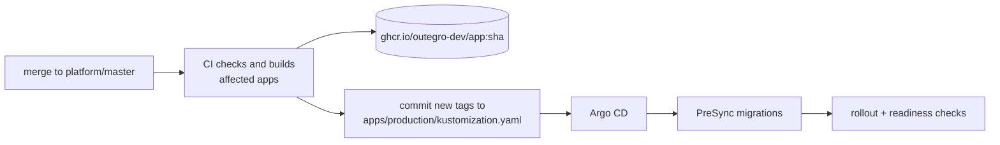

# outegro-dev / gitops

**Desired state of the [outegro.dev](https://outegro.dev) production cluster.** Argo CD watches only this repository and keeps the cluster in sync with `master`. Application code lives in [outegro-dev/platform](https://github.com/outegro-dev/platform).


## Layout

```text
node/              VPS setup: bootstrap, SSH hardening, firewall, K3s, Argo CD, secrets
bootstrap/         root.yaml — the only application applied by hand
applications/      Argo CD applications (app of apps), one per component
platform/          cluster components: Argo CD, Sealed Secrets, cert-manager,
                   CloudNativePG, Barman Cloud, certificate issuer, monitoring
apps/production/   outegro.dev services and their data: PostgreSQL, Valkey, RabbitMQ,
                   apps, migrations (PreSync), network policies, Sealed Secrets
apps/agents/       Hermes, a self-hosted AI agent locked down by network and tool policy
```

Third-party versions are pinned in `platform/*/kustomization.yaml`; an upgrade is a PR that changes the version in the URL.

## How a release lands



1. A merge to `master` in `platform` → CI checks and builds images `ghcr.io/outegro-dev/<app>:<commit>`.
2. CI commits the new tag into the `images` block of `apps/production/kustomization.yaml`.
3. Argo CD picks up the commit: PreSync migrations → rollout → readiness checks.

Rollback is `git revert` of the tag commit. Infrastructure changes are ordinary commits here.

## Secrets

Sealed Secrets only: encrypted with the controller key and safe to keep in git. Plain values never leave the server.

```sh
# put a new provider key on the server
<KEY=value> | ssh outegro-prod 'sudo bash /tmp/secrets.sh'
# seal it into the repository
ssh outegro-prod 'sudo bash -s -- outegro/<name>' < node/seal.sh > apps/production/secrets/<name>.yaml
```

The Sealed Secrets controller private key and the K3s encryption key are kept by the owner: without them this repository cannot be restored onto a new server.

## New server

In `node/`: `bootstrap.sh` → `harden-ssh.sh` → `firewall.sh` → `install-k3s.sh` → `install-argocd.sh` (prints the GitHub deploy key) → restore the Sealed Secrets key → `kubectl apply -f bootstrap/root.yaml`. Argo CD brings up everything else.

## Argo CD access

The UI is not exposed publicly:

```sh
ssh -L 8080:localhost:8080 outegro-prod 'sudo k3s kubectl -n argocd port-forward svc/argocd-server 8080:443'
# https://localhost:8080, user admin, password:
ssh outegro-prod "sudo k3s kubectl -n argocd get secret argocd-initial-admin-secret -o jsonpath='{.data.password}' | base64 -d"
```

## Monitoring

Prometheus (node, Kubernetes, PostgreSQL, RabbitMQ, Traefik and cert-manager metrics; 7 days) and Loki (pod logs collected by Alloy; 7 days) — the `monitoring` application, values in `platform/monitoring`. Neither is exposed publicly. Rules from `platform/monitoring/extra/rules.yaml` reach Telegram through a watchdog that reads the Prometheus alerts API every 5 minutes.

```sh
ssh -L 9090:localhost:9090 outegro-prod 'sudo k3s kubectl -n monitoring port-forward svc/monitoring-prometheus 9090'
# http://localhost:9090 — queries and the Alerts tab
ssh -L 3100:localhost:3100 outegro-prod 'sudo k3s kubectl -n monitoring port-forward svc/loki 3100'
# logs: curl -G localhost:3100/loki/api/v1/query_range --data-urlencode 'query={namespace="outegro",app="battleship-backend"}'
```

Grafana is served at `admin.outegro.dev/grafana` behind the admin console's SSO.

---

<sub>Built and operated by <a href="https://github.com/coping-barrel">Nick Lukashik</a> · <a href="https://outegro.dev">outegro.dev</a></sub>
